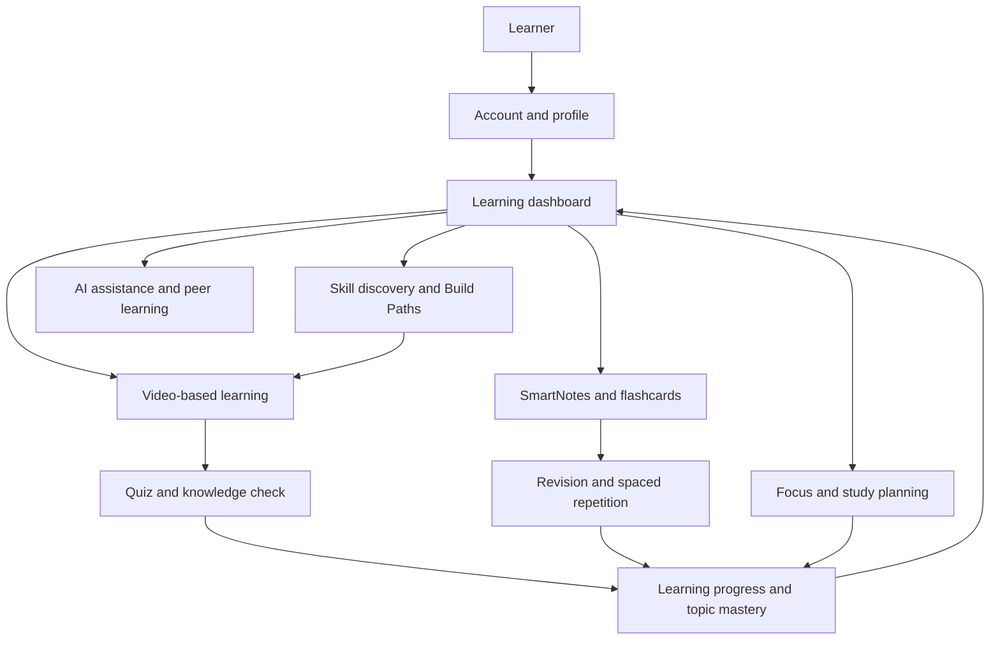
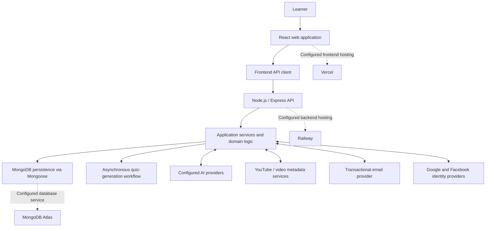

# EduVerse — Learn with Structure. Build Lasting Understanding.

<div align="center">


**One connected workspace for learning, practice, revision, and student productivity.**

[](https://react.dev/)
[](https://nodejs.org/)
[](https://expressjs.com/)
[](https://www.mongodb.com/)
[](https://vite.dev/)

[Explore the platform](#01--what-is-eduverse) · [Explore the learning journey](#02--the-eduverse-learning-journey) · [Explore features](#03--one-platform-multiple-learning-workflows) · [Run locally](#10--getting-started) · [Testing](#13--testing-and-quality-checks)

[GitHub Repository](https://github.com/KartikeyG-world/EduVerse) · [Report an issue](https://github.com/KartikeyG-world/EduVerse/issues)

</div>

---

## Contents

- [01 — What is EduVerse?](#01--what-is-eduverse)
- [02 — The EduVerse learning journey](#02--the-eduverse-learning-journey)
- [03 — One platform, multiple learning workflows](#03--one-platform-multiple-learning-workflows)
- [04 — What connects the experience](#04--what-connects-the-experience)
- [05 — Platform architecture](#05--platform-architecture)
- [06 — Technology stack](#06--technology-stack)
- [07 — Security, privacy, and responsible AI](#07--security-privacy-and-responsible-ai)
- [08 — Application screenshots](#08--application-screenshots)
- [09 — Project structure](#09--project-structure)
- [10 — Getting started](#10--getting-started)
- [11 — Environment configuration](#11--environment-configuration)
- [12 — Running the application](#12--running-the-application)
- [13 — Testing and quality checks](#13--testing-and-quality-checks)
- [14 — Current scope and known boundaries](#14--current-scope-and-known-boundaries)
- [15 — Deployment overview](#15--deployment-overview)
- [16 — Project documentation](#16--project-documentation)
- [17 — Contributing](#17--contributing)
- [18 — Maintainer and license](#18--maintainer-and-license)

---

## 01 — What is EduVerse?

EduVerse is a full-stack learning platform designed to bring several parts of a student's learning routine into one connected experience.

Learning often happens across separate tools: a learner watches a lesson in one place, keeps notes somewhere else, practises with a separate quiz, tracks goals in a planner, and tries to understand progress from scattered activity. EduVerse brings these workflows together around a learner's account and learning progress.

The platform combines:

- **Structured learning:** discover skills and follow guided learning paths.
- **Video-based study:** learn through educational videos and supported watch-progress workflows.
- **Knowledge checks:** practise with quizzes and receive server-evaluated results.
- **Knowledge capture:** organise study material in rich-text notes.
- **Active revision:** create and review flashcards using spaced-repetition workflows.
- **Learning support:** use AI-assisted help, chat, and peer-learning features where available.
- **Progress and productivity:** review learning activity, manage focus sessions, plan study routines, and track student expenses.

The idea is not to replace every learning resource. It is to make the work around learning more organised, connected, and easier to revisit.

> **EduVerse principle:** Learning activity is useful only when it helps the learner understand what to study next, practise deliberately, and retain what has been learned.

## 02 — The EduVerse learning journey

The following diagram is a high-level view of how the main learning workflows relate. Individual modules can also be used independently; the diagram is not a mandatory linear sequence.



### The learner's loop

1. **Choose a direction.** Explore a skill or follow a structured learning path.
2. **Study and practise.** Use learning content and the supported quiz workflow to check understanding.
3. **Capture knowledge.** Keep useful explanations and study material in notes.
4. **Revisit important concepts.** Use flashcards and revision workflows to reinforce recall.
5. **Review progress.** Use the dashboard and analytics to understand learning activity and areas to revisit.
6. **Build consistency.** Use focus sessions and study planning tools to organise the work.

## 03 — One platform, multiple learning workflows

EduVerse is organised around learner-facing experiences rather than a collection of disconnected utilities.

| Learning area | What it helps the learner do |
|---|---|
| **Dashboard** | Get a central view of learning activity, progress, and relevant shortcuts. |
| **SkillHub** | Explore available skills and learning opportunities. |
| **Build Paths** | Follow structured, multi-stage learning journeys and track progress through milestones. |
| **Video Learning** | Study educational videos and use supported watch-progress and quiz workflows. |
| **Quizzes** | Check comprehension and receive results evaluated by the backend. |
| **SmartNotes** | Create and organise rich-text study notes. |
| **Flashcards** | Turn learning material into review cards and practise through spaced-repetition workflows. |
| **AI Chat and Tutor** | Get AI-assisted learning support and use peer-learning/problem-discussion features. |
| **Focus Mode** | Organise focused study sessions with a Pomodoro-style workflow. |
| **Study Planner** | Organise routines and study plans. |
| **Analytics** | Review learning activity and progress trends. |
| **Profile** | View account information, learning statistics, and achievement-related information. |
| **Expense Tracker** | Record and review student-related expenses. |

### Account and access experience

The application includes account registration, sign-in, email OTP verification, password recovery, and profile workflows. Google and Facebook identity integrations are also part of the reported application scope; their availability depends on correct provider configuration.

### Learning support and community

The Tutor and Chat experiences support different forms of help: AI-assisted conversation and peer-oriented problem/solution workflows. These should be understood as learning support features, not a substitute for instructor judgement or authoritative academic assessment.

## 04 — What connects the experience

EduVerse includes several shared learning systems that allow different modules to contribute to a learner's broader progress.

### Learning progress and topic mastery

Learning activity can contribute to skill and topic progress. The platform includes topic-mastery records and progress views intended to give learners a more structured picture of their development.

### Server-evaluated knowledge checks

The video quiz workflow separates quiz generation, job status, answer submission, and result evaluation. The backend is responsible for authoritative grading and associated progress updates; the README does not expose internal grading rules or private scoring logic.

### Notes and revision

SmartNotes provides a rich-text environment for capturing learning material. Flashcards provide a separate review experience so that learners can revisit concepts rather than relying only on rereading notes.

### Focus and study routines

Focus Mode and Study Planner support the organisation of study time. They complement the learning modules; they do not guarantee a particular learning outcome or productivity result.

### AI-assisted learning

AI services are used in supported assistance and content-generation workflows. AI output can be incomplete or incorrect and should be checked against trusted learning resources.

## 05 — Platform architecture

EduVerse follows a client–API–database architecture. The diagram below describes the project's reported architecture and configured service relationships; it does not claim that every external service or production environment is currently live.



### Architectural boundaries

- The **frontend** is responsible for the learner-facing interface and interaction.
- The **backend API** handles application operations, validation, authentication boundaries, and domain workflows.
- **MongoDB** stores application records through Mongoose models.
- **External providers** supply selected AI, video metadata, email, and identity capabilities.
- The quiz workflow uses persisted job state and backend worker processing, as described in the latest remediation report.

## 06 — Technology stack

The following table lists the main technologies reported in the project. Exact package versions should be read from the current package manifests and lockfiles rather than copied from a static README badge.

| Layer | Technologies | Role |
|---|---|---|
| Frontend | React, Vite, Tailwind CSS | User interface and frontend build pipeline |
| Frontend state and requests | React Context, Axios | Shared client state and API communication |
| Rich-text editing | TipTap | Structured note editing |
| Backend | Node.js, Express | Application server and API layer |
| Data access | MongoDB, Mongoose | Persistent application data and schema models |
| AI integrations | Configured AI gateway/providers | AI-assisted learning and content workflows |
| Video integrations | YouTube-related services | Video discovery and metadata workflows |
| Email | Brevo | Transactional email workflows |
| Identity | Google and Facebook integrations | Federated sign-in options |
| Hosting configuration | Vercel, Railway, MongoDB Atlas | Reported target deployment services |

## 07 — Security, privacy, and responsible AI

EduVerse handles account and learning data. Security and privacy should be treated as part of the product, not as optional setup details.

The project reports the following controls and design practices:

- Browser session authentication uses **HttpOnly cookie transport** rather than exposing the session token to ordinary application JavaScript storage.
- Authenticated API operations use backend-side identity and access checks.
- Request validation and security middleware are part of the backend API boundary.
- Rich-text note content is sanitised before persistence and also protected at the rendering layer.
- User-facing public information should not expose private account or learning records.
- External integrations are configuration-dependent and require their own provider credentials.

These statements describe the reported design, not a guarantee that every possible security property has been independently certified or that the application satisfies a regulatory standard.

### Responsible use of AI

AI-generated explanations, recommendations, summaries, and quiz material can contain errors. Learners should validate important information against course material, textbooks, instructors, or other trusted references.

Do not enter passwords, API keys, private credentials, or unnecessary sensitive personal information into AI prompts or shared learning content.

## 08 — Application screenshots

The existing EduVerse hero image reference is intentionally preserved at the top of this README:

`frontend/src/assets/hero.png`

The following screenshot gallery contains genuine, full-resolution (1440 × 900) captures of all 18 unique user-facing pages discovered in the application routing hierarchy. All screens were captured from the running local application using synthetic demonstration data.

**Screenshot asset directory:** `docs/screenshots/application/`

<details>
<summary><strong>Authentication</strong></summary>

### 01 — Sign In


### 02 — Create Account


### 03 — Verify OTP


### 04 — Forgot Password


### 05 — Reset Password


</details>

<details>
<summary><strong>Core learning workspace</strong></summary>

### 06 — Learner Dashboard


### 07 — SkillsHub


### 08 — Build Paths


### 09 — Learning View


</details>

<details>
<summary><strong>Knowledge and revision</strong></summary>

### 10 — SmartNotes


### 11 — Flashcard Study


</details>

<details>
<summary><strong>Assistance and productivity</strong></summary>

### 12 — AI Chatbot


### 13 — Peer & AI Tutor


### 14 — Focus Mode


### 15 — Study Planner


### 16 — Learning Analytics


### 17 — Educational Expense Tracker


### 18 — Learner Profile


</details>

## 09 — Project structure

EduVerse is organised into separate frontend and backend workspaces. This is a high-level orientation map; it intentionally avoids publishing every internal file or implementation detail.

```text
EduVerse/
├── backend/
│   ├── controllers/       # Request-level application handlers
│   ├── integrations/      # External service adapters
│   ├── middlewares/       # Authentication and request middleware
│   ├── models/            # Persistent data models
│   ├── routes/            # API route modules
│   ├── scripts/           # Administrative and migration utilities
│   ├── services/          # Domain and background services
│   ├── tests/             # Backend automated tests
│   └── utils/             # Shared backend utilities
│
├── frontend/
│   ├── public/            # Static public assets
│   └── src/
│       ├── components/    # Reusable UI components
│       ├── context/       # Shared application state
│       ├── pages/         # Main application experiences
│       ├── utils/         # Frontend utilities and API client
│       └── assets/        # Branding and visual assets
│
├── .env.example          # Environment variable template
└── README.md
```

The exact folder contents may evolve. Use the current repository tree as the source of truth when navigating the codebase.

## 10 — Getting started

### Prerequisites

- Node.js 20 or later, subject to the current project runtime requirements.
- npm.
- Git.
- A MongoDB instance or an authorised MongoDB Atlas development database.
- Provider credentials for any external integration you intend to exercise locally.

### 1. Clone the repository

```bash
git clone https://github.com/KartikeyG-world/EduVerse.git
cd EduVerse
```

### 2. Install backend dependencies

```bash
cd backend
npm ci
```

### 3. Configure the backend environment

The repository includes a root `.env.example` template. Follow the current project configuration and server startup requirements when creating the local backend environment file. Use development-only credentials and a development database.

Do not copy production secrets into a local environment, commit `.env` files, or point a local test run at the production database.

### 4. Install frontend dependencies

Open a second terminal at the repository root:

```bash
cd frontend
npm ci
```

### 5. Configure frontend environment values

Set the frontend API base URL and any required public client identifiers using the variable names expected by the current frontend API client and Vite configuration. Check the current environment template and source configuration before adding variables; do not assume that similarly named variables are interchangeable.

## 11 — Environment configuration

Environment variable names and requiredness can change as integrations evolve. The root `.env.example` and the current application configuration are authoritative.

Common configuration areas include:

| Configuration area | Examples of variable names | Purpose |
|---|---|---|
| Database | `MONGO_URI` | Connection to the development or deployed MongoDB database |
| Authentication | `JWT_SECRET`, `GOOGLE_CLIENT_ID` | Session signing and identity-provider configuration |
| Social identity | `FACEBOOK_APP_ID`, `FACEBOOK_APP_SECRET` | Facebook identity integration |
| Email | `BREVO_API_KEY`, `BREVO_SENDER_EMAIL` | Transactional email delivery |
| AI services | `OPENROUTER_API_KEY`, `GEMINI_API_KEY` | Configured AI provider access |
| Video metadata | `YOUTUBE_API_KEY` | YouTube-related metadata functionality |
| Frontend API | `VITE_API_URL`, `VITE_API_BASE_URL` | Frontend-to-backend API configuration, where supported by the current client |
| Frontend identity | `VITE_GOOGLE_CLIENT_ID`, `VITE_FACEBOOK_APP_ID` | Public client identifiers for supported identity integrations |

This table is an orientation aid, not a replacement for `.env.example`. Confirm which variables are required, optional, or environment-specific before starting the application. Never place secret values in this README.

## 12 — Running the application

Run the backend and frontend in separate terminals.

**Terminal 1 — Backend**

```bash
cd backend
npm run dev
```

**Terminal 2 — Frontend**

```bash
cd frontend
npm run dev
```

Open the local address printed by Vite in the terminal. The API base URL must point to the locally running backend or to the configured development proxy.

If startup fails, check the backend environment, database connectivity, the configured API base URL, and whether the required local ports are available.

## 13 — Testing and quality checks

Run commands from the workspace that owns the relevant package manifest.

### Backend tests

```bash
cd backend
node --test tests/*.test.js
```

The backend test suite includes coverage for application services, security controls, learning workflows, and MongoDB integration behavior. Some integration tests use an isolated MongoDB test instance; do not redirect them to a shared or production database.

### Frontend lint

```bash
cd frontend
npm run lint
```

### Frontend production build

```bash
cd frontend
npm run build
```

### Verification boundaries

- Unit and integration tests do not automatically prove full browser behavior.
- A successful frontend build does not establish that the deployed frontend and backend communicate correctly.
- Local MongoDB migration tests do not establish that the production Atlas migration has been executed.
- External provider integrations require valid provider-side configuration to test end to end.
- Browser-driven E2E coverage should be reported separately from unit and integration test results.

Do not treat test counts or build timings in historical audit documents as permanent README badges. Rerun the current commands when reporting a new verification result.

## 14 — Current scope and known boundaries

The table below describes the broad product scope. Availability of individual integrations can depend on configuration, provider quotas, deployment state, and the user's account permissions.

| Area | Scope represented in the project | Important boundary |
|---|---|---|
| Learning paths and skills | Skill discovery and structured learning paths | Content availability depends on the configured data and services |
| Video learning and quizzes | Video study, watch-progress workflow, quiz generation and evaluation | External video/AI provider availability may affect some workflows |
| Notes and flashcards | Rich-text notes and revision cards | Generated content should be reviewed by the learner |
| AI and peer support | AI chat/tutor and peer-learning workflows | AI output can be inaccurate; external providers may be unavailable |
| Topic mastery and analytics | Learning progress and activity views | These are application-level learning indicators, not formal academic grades |
| Focus and planning | Focus sessions and study routines | Tools support organisation; they do not guarantee productivity outcomes |
| Expense tracking | Student expense records and summaries | Users remain responsible for the accuracy of entered financial data |

### Operational release note

The latest supplied Antigravity report describes the code-level remediation work as ready for production review, but it still records the live TopicMastery Atlas migration as pending. It also reports that production environment configuration and some deployed-environment checks require operator verification. This README is not a production release approval; consult the current release evidence and authorised operator checklist before a deployment.

## 15 — Deployment overview

The project documentation describes a deployment arrangement using:

- **Vercel** for the frontend application and routing configuration.
- **Railway** for the backend service.
- **MongoDB Atlas** for hosted database persistence.

The actual deployed domains, environment values, provider credentials, database indexes, and live health status must be checked in the relevant service dashboards and release records. No production URLs or secret values are embedded here because they must be confirmed from the active deployment configuration.

Database migrations are operational tasks. They must be run by an authorised operator, against the explicitly confirmed target database, after the required backup and dry-run review. Do not execute production migrations automatically during application startup.

## 16 — Project documentation

The repository may include additional engineering and product documents. Link only to files that exist in the current repository and that are intended for the relevant audience.

Useful documentation categories include:

- Product requirements and product vision.
- Engineering rules and contributor guidance.
- API and integration documentation.
- QA and test reports.
- Deployment and operational runbooks.

Operational audits, private security findings, environment inventories, migration procedures, and internal evidence registers should remain separate from this public-facing README unless the project owner explicitly intends to publish them.

## 17 — Contributing

Contributions should be focused, reviewable, and supported by evidence.

1. Fork the repository or create an authorised feature branch.
2. Keep changes scoped to one feature or fix where practical.
3. Preserve existing authentication, data-isolation, and validation boundaries.
4. Add or update tests for behaviour changes.
5. Update documentation when user-visible behaviour or setup changes.
6. Run the relevant backend tests, frontend lint, and frontend build before opening a pull request.
7. Explain the purpose, implementation impact, verification performed, and any known limitations in the pull request.

Do not commit `.env` files, credentials, local database dumps, personal user data, or generated files that are not intended for version control.

## 18 — Maintainer and license

**Repository:** [KartikeyG-world/EduVerse](https://github.com/KartikeyG-world/EduVerse)
**Maintainer attribution in the current project README:** Kartik Gupta
**GitHub:** [@KartikeyG-world](https://github.com/KartikeyG-world)
**LinkedIn:** [Kartik Gupta](https://www.linkedin.com/in/kartik-gupta-tgw20/)

The repository's root-level license file, if present, is the authority for reuse and redistribution. Do not assume an MIT or other open-source license unless the actual license file confirms it.

---

<div align="center">

**EduVerse**

*Learn with structure. Practise with purpose. Track your progress.*

[Repository](https://github.com/KartikeyG-world/EduVerse) · [Issues](https://github.com/KartikeyG-world/EduVerse/issues)

</div>
